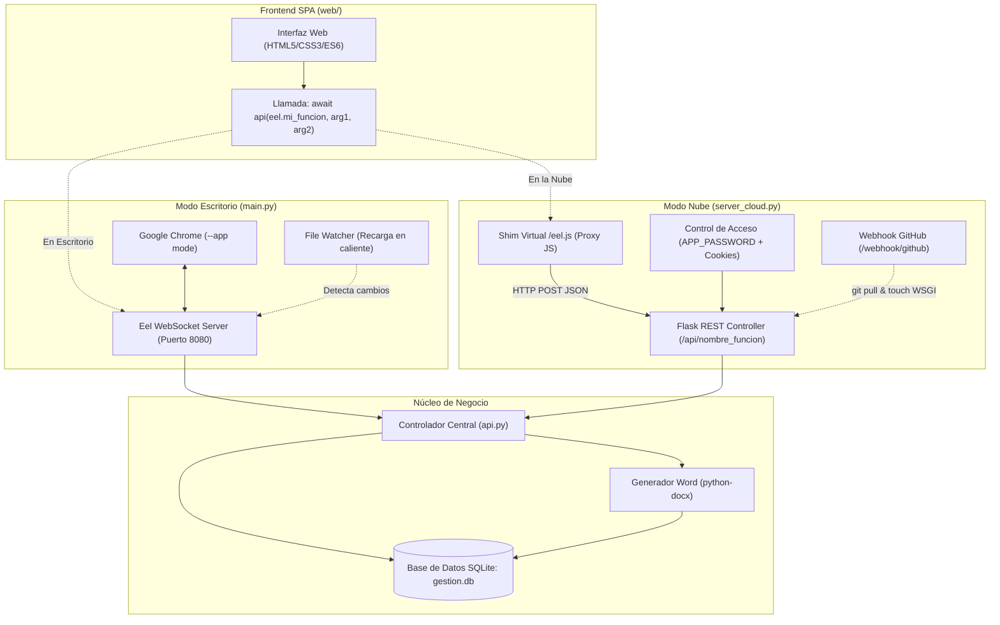

# Arquitectura del Sistema Nicole

Este documento detalla los componentes estructurales, flujos de ejecución, modelos de ejecución dual (Escritorio vs. Nube) y mecanismos de integración del sistema.

---

## 1. Visión General y Diagrama de Flujo

El sistema Nicole está concebido bajo una **arquitectura híbrida**: una única base de código fuente frontend (SPA en JavaScript Vanilla) y un único núcleo de lógica de negocio en Python (`api.py`), capaces de ejecutarse tanto como una aplicación de escritorio Windows sin conexión a internet, como un servicio web seguro en la nube para dispositivos móviles / iPhone.



---

## 2. Modo Escritorio (Local Desktop — `main.py`)

### 2.1 Componentes y Funcionamiento
1. **Servidor Eel**: Inicializa el directorio `web/` y expone el puerto `8080` vinculándose a `0.0.0.0` (permitiendo acceso local y desde otros dispositivos en la red LAN doméstica/oficina).
2. **Lanzador de Ventana Chrome**: 
   - Intenta ubicar `chrome.exe` en la ruta estándar de Windows (`C:\Program Files\Google\Chrome\Application\chrome.exe`).
   - Lanza Chrome en modo aplicación limpia: `--app=http://localhost:8080/index.html` (sin barra de direcciones ni pestañas, simulando una app de escritorio nativa).
   - Si Chrome no está disponible, delega en el navegador predeterminado mediante `webbrowser.open()`.
3. **Guardia de Instancia Única**:
   - Antes de abrir el servidor, realiza un sondeo al puerto 8080 (`s.connect_ex(('localhost', 8080))`).
   - Si la aplicación ya está corriendo en segundo plano, simplemente abre una nueva ventana y termina el proceso actual para evitar colisiones de puerto.
4. **File Watcher en Caliente (`watch_web_files`)**:
   - Un hilo demonio secundario inspecciona las marcas de tiempo (`mtime`) de todos los archivos en `web/` cada segundo.
   - Si se guarda un cambio en `app.js`, `style.css` o `index.html`, activa la bandera `_reload_needed`.
   - El frontend sondea periódicamente `eel.check_reload()` y refresca automáticamente la interfaz sin requerir reiniciar el script de Python.

---

## 3. Modo Nube (Cloud Server — `server_cloud.py`)

### 3.1 El Shim Virtual `/eel.js`
En servidores estándar (como PythonAnywhere, Render o Railway), Eel no puede mantener fácilmente WebSockets bidireccionales con navegadores móviles detrás de proxies inversos WSGI. Para solucionar esto:
- El servidor Flask intercepta las solicitudes a `/eel.js` y entrega un script JavaScript dinámico basado en `Proxy`.
- Cuando el frontend ejecuta `window.eel.mi_funcion(a, b)()`, el Proxy captura el nombre del método y sus argumentos.
- En lugar de usar WebSockets, realiza una petición estándar:
  ```javascript
  fetch('/api/' + encodeURIComponent(prop), {
      method: 'POST',
      credentials: 'same-origin',
      headers: { 'Content-Type': 'application/json' },
      body: JSON.stringify({ args: args })
  })
  ```
- El resultado se desempaqueta y se devuelve como una Promesa nativa idéntica a la que espera Eel.

### 3.2 Auto-Descubrimiento y Lista Blanca de la API
Para evitar vulnerabilidades de ejecución remota de código:
- `server_cloud.py` inspecciona dinámicamente el módulo `api.py` al arrancar.
- Filtra únicamente funciones que pertenezcan explícitamente a `api.py` y cuyo nombre **no comience con guión bajo (`_`)**.
- Los endpoints HTTP `/api/<fn_name>` verifican contra `ALLOWED_API`. Cualquier intento de invocar módulos externos, sentencias SQL directas o funciones privadas es rechazado con error `404/403`.

### 3.3 Seguridad y Autenticación
1. **Contraseña Maestra (`APP_PASSWORD`)**:
   - Si está definida, toda solicitud a la app o a `/api/*` requiere autenticación previa mediante sesión firmada.
   - El formulario de `/login` cuenta con un limitador en memoria de **5 intentos fallidos cada 15 minutos por IP**.
2. **Firma Criptográfica (`SECRET_KEY`)**:
   - Se toma de las variables de entorno o se genera automáticamente en un archivo local `.secret_key` con permisos restringidos.
   - Cookies configuradas con `HttpOnly=True`, `SameSite="Lax"` y `Secure=True` (salvo en pruebas locales).
3. **Cabeceras de Protección**:
   - `Content-Security-Policy: frame-ancestors 'none'; object-src 'none'; base-uri 'self'`
   - `X-Content-Type-Options: nosniff`
   - `X-Frame-Options: DENY`
   - `Strict-Transport-Security: max-age=31536000`
   - `Cache-Control: no-store` en todas las respuestas JSON de la API.

### 3.4 Despliegue Continuo (CI/CD) con GitHub Webhook
- **Endpoint**: `/webhook/github`
- Valida la firma `X-Hub-Signature-256` utilizando `hmac.new(GITHUB_WEBHOOK_SECRET, ..., sha256)`.
- Ejecuta `git pull origin master` de forma asíncrona dentro del directorio del proyecto.
- Si se ejecuta en PythonAnywhere, ejecuta `os.utime()` sobre los archivos `*_wsgi.py` para recargar los procesos de los workers inmediatamente sin requerir acceso al panel de administración.

---

## 4. Persistencia y Base de Datos (SQLite)

- **Modo WAL (Write-Ahead Logging)**: Configurado en `init_db()` (`PRAGMA journal_mode=WAL;`), lo que permite que múltiples hilos o peticiones concurrentes lean la base de datos simultáneamente mientras se realizan transacciones de escritura sin bloquear el archivo `gestion.db`.
- **Integridad Referencial**: Activada en cada conexión con `PRAGMA foreign_keys = ON;`.
- **Formato de Retorno**: Cada cursor utiliza `conn.row_factory = sqlite3.Row`, permitiendo acceder a los campos tanto por índice numérico como por nombre de columna asociativo.
- **Migraciones Idempotentes**: Se ejecutan dentro de bloques `try/except` en `database.py:init_db()`. Las nuevas columnas se agregan dinámicamente sin riesgo de borrar registros existentes.

---

## 5. Pipeline de Generación de Cotizaciones en Word (`python-docx`)

1. El usuario diseña la cotización en la vista de Trabajo (cliente, sede, validez, condiciones comerciales y catálogo de servicios con insumos y equipos).
2. Se invoca `api.generate_quote_word(quote_id)`.
3. El backend carga la plantilla maestra `templates/cotizacion_base.docx`.
4. Reemplaza marcadores de posición en párrafos y tablas (`[NUMERO]`, `[CLIENTE]`, `[FECHA]`, etc.).
5. Genera dinámicamente las filas de descripción técnica detallando los productos químicos formulados y maquinarias asignadas.
6. Devuelve el archivo codificado en Base64 para que el frontend lo descargue automáticamente en la computadora o dispositivo móvil.
